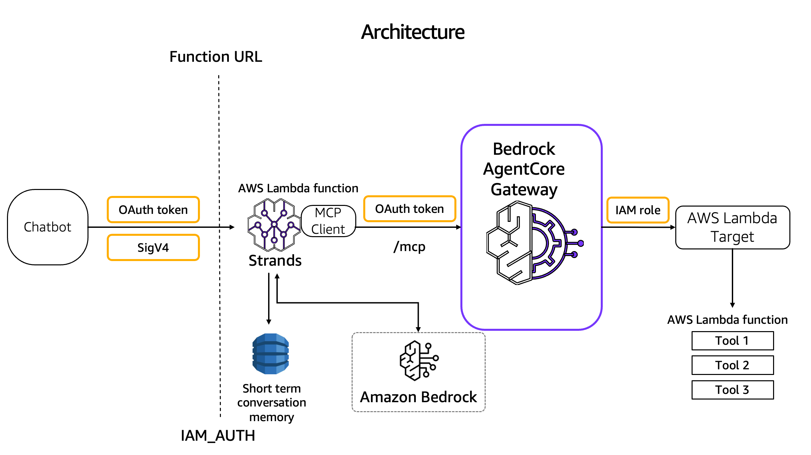

# Architecture Flow - Bedrock AgentCore Gateway MCP Integration

---
## 📋 Navigation
**🏠 [README](../README.md)** | **📖 [Setup Guide](SETUP.md)** | **🏗️ [Architecture](ARCHITECTURE-FLOW.md)** | **🔧 [Scripts](../scripts/README.md)** | **🤖 [Client](../client/README.md)** | **⚙️ [Config](../configs/README.md)** | **🔐 [Okta Setup](../okta-auth/OKTA-OPENID-PKCE-SETUP.md)**
---

## System Architecture



## Component Overview

### Client Application
- **CLI Interface**: Interactive command-line client
- **Authentication**: AWS SigV4 + Okta JWT
- **Conversation Management**: Persistent chat history
- **Natural Language**: Human-friendly AWS operations

### Function URL
- **Direct Lambda Access**: No API Gateway required
- **Authentication**: AWS SigV4 (IAM_AUTH)
- **Streaming Support**: Real-time AI responses
- **CORS Enabled**: For web client compatibility

### AWS Operations Agent Lambda
- **Strands Agent**: AI-powered conversation manager
- **MCP Client**: Connects to Bedrock AgentCore Gateway
- **DynamoDB Integration**: Conversation persistence
- **Streaming Responses**: Real-time AI output

### Bedrock AgentCore Gateway
- **MCP Server**: Model Context Protocol implementation
- **Authentication**: Okta JWT validation
- **Target Management**: Lambda function invocation
- **Tool Registration**: 20 AWS service tools

### MCP Tool Lambda
- **Docker Container**: Consistent runtime environment
- **AWS SDK**: Access to 20+ AWS services
- **Tool Implementation**: Natural language AWS operations
- **Security**: Read-only operations by default

### DynamoDB
- **Conversation Storage**: Persistent chat history
- **TTL Support**: Automatic expiration of old conversations
- **On-Demand Capacity**: Cost-effective scaling
- **Point-in-Time Recovery**: Data protection

## Detailed Component Diagrams

### Client Application

```
┌─────────────────────────────────────────────────────────────────┐
│                                                                 │
│                      Client Application                         │
│                                                                 │
│  ┌─────────────────────────────────────────────────────────┐    │
│  │              Command Line Interface                     │    │
│  │  • Interactive prompt with command history              │    │
│  │  • Streaming response display                           │    │
│  │  • Tool invocation visualization                        │    │
│  │  • Conversation management commands                     │    │
│  └─────────────────────────────────────────────────────────┘    │
│                                                                 │
│  ┌─────────────────────────────────────────────────────────┐    │
│  │              Authentication Manager                     │    │
│  │  • AWS SigV4 signing for Lambda Function URL            │    │
│  │  • Okta token management for MCP authentication         │    │
│  │  • Token refresh and validation                         │    │
│  │  • Profile selection (demo1, etc.)                      │    │
│  └─────────────────────────────────────────────────────────┘    │
│                                                                 │
│  ┌─────────────────────────────────────────────────────────┐    │
│  │              HTTP Client                                │    │
│  │  • Streaming response handling                          │    │
│  │  • Request retry with exponential backoff               │    │
│  │  • Timeout management                                   │    │
│  │  • Error handling and reporting                         │    │
│  └─────────────────────────────────────────────────────────┘    │
│                                                                 │
│  Client ID: cli-client-<random-id>                              │
│  AWS Profile: demo1                                             │
│  AWS Region: us-east-1                                          │
│  Okta Token: ***REMOVED***                  │
│                                                                 │
└─────────────────────────────────────────────────────────────────┘
```

### Function URL

```
┌─────────────────────────────────────────────────────────────────┐
│                                                                 │
│                      Lambda Function URL                        │
│                                                                 │
│  URL: https://<unique-id>.lambda-url.us-east-1.on.aws/          │
│  Auth Type: AWS_IAM                                             │
│  Invoke Mode: RESPONSE_STREAM                                   │
│                                                                 │
│  ┌─────────────────────────────────────────────────────────┐    │
│  │              Authentication                             │    │
│  │  • AWS SigV4 validation                                 │    │
│  │  • IAM policy enforcement                               │    │
│  │  • No additional authorization layer needed             │    │
│  └─────────────────────────────────────────────────────────┘    │
│                                                                 │
│  ┌─────────────────────────────────────────────────────────┐    │
│  │              CORS Configuration                         │    │
│  │  • AllowOrigins: *                                      │    │
│  │  • AllowMethods: *                                      │    │
│  │  • AllowHeaders: *                                      │    │
│  │  • AllowCredentials: true                               │    │
│  │  • MaxAge: 86400                                        │    │
│  └─────────────────────────────────────────────────────────┘    │
│                                                                 │
│  ┌─────────────────────────────────────────────────────────┐    │
│  │              Endpoints                                  │    │
│  │  • /stream - Streaming chat responses                   │    │
│  │  • /chat - Non-streaming chat                           │    │
│  │  • /api/conversations - Conversation management         │    │
│  │  • /api/tools/fetch - Available MCP tools               │    │
│  └─────────────────────────────────────────────────────────┘    │
│                                                                 │
└─────────────────────────────────────────────────────────────────┘
```

### AWS Operations Agent Lambda

```
┌─────────────────────────────────────────────────────────────────┐
│                                                                 │
│                   AWS Operations Agent Lambda                   │
│                                                                 │
│  Function Name: aws-operations-agent-<environment>              │
│  Runtime: Python 3.11 (Container Image)                         │
│  Memory: 1536 MB                                                │
│  Timeout: 300 seconds                                           │
│                                                                 │
│  ┌─────────────────────────────────────────────────────────┐    │
│  │              FastAPI Application                        │    │
│  │  • AWS Lambda Web Adapter integration                   │    │
│  │  • Streaming response support                           │    │
│  │  • API endpoints for conversation management            │    │
│  │  • Error handling and validation                        │    │
│  └─────────────────────────────────────────────────────────┘    │
│                                                                 │
│  ┌─────────────────────────────────────────────────────────┐    │
│  │              Strands Agent                              │    │
│  │  • Claude 3.7 Sonnet integration                        │    │
│  │  • Tool selection and execution                         │    │
│  │  • Conversation context management                      │    │
│  │  • Natural language understanding                       │    │
│  └─────────────────────────────────────────────────────────┘    │
│                                                                 │
│  ┌─────────────────────────────────────────────────────────┐    │
│  │              MCP Client                                 │    │
│  │  • Bedrock AgentCore Gateway integration                │    │
│  │  • Tool discovery and invocation                        │    │
│  │  • Authentication with Okta token                       │    │
│  │  • Error handling and retries                           │    │
│  └─────────────────────────────────────────────────────────┘    │
│                                                                 │
│  ┌─────────────────────────────────────────────────────────┐    │
│  │              DynamoDB Integration                       │    │
│  │  • Conversation persistence                             │    │
│  │  • Message history management                           │    │
│  │  • TTL for automatic cleanup                            │    │
│  │  • Optimistic locking for concurrent access             │    │
│  └─────────────────────────────────────────────────────────┘    │
│                                                                 │
└─────────────────────────────────────────────────────────────────┘
```

### Bedrock AgentCore Gateway

```
┌─────────────────────────────────────────────────────────────────┐
│                                                                 │
│                    Bedrock AgentCore Gateway                    │
│                                                                 │
│  Gateway ID: example-gateway-<random-id>                        │
│  Data Plane URL: https://<gateway-id>.gateway.bedrock-agentcore.│
│                  <region>.amazonaws.com/mcp                     │
│  Execution Role: BedrockAgentCoreGatewayExecutionRole-<env      │
│  Service Account: (bedrock-agentcore-control)                   │
└─────────────────────────────────────────────────────────────────┘
                                │
                                ▼
┌─────────────────────────────────────────────────────────────────┐
│                                                                 │
│                    Bedrock AgentCore Target                     │
│                                                                 │
│  ┌─────────────────────────────────────────────────────────┐    │
│  │              Target Configuration                       │    │
│  │  • Name: example-mcp-target                             │    │
│  │  • Type: Lambda                                         │    │
│  │  • Status: READY                                        │    │
│  │  • Tool Count: 20                                       │    │
│  └─────────────────────────────────────────────────────────┘    │
│                                                                 │
│  ┌─────────────────────────────────────────────────────────┐    │
│  │              Authentication                             │    │
│  │  • JWT Validation (Okta)                                │    │
│  │  • Audience: api://default                              │    │
│  │  • Discovery URL: https://dev-12345678.okta.com/oauth2/ │    │
│  │                default/.well-known/openid-configuration │    │
│  └─────────────────────────────────────────────────────────┘    │
│                                                                 │
│  ┌─────────────────────────────────────────────────────────┐    │
│  │              MCP Protocol                               │    │
│  │  • JSON-RPC 2.0 over HTTPS                              │    │
│  │  • Tool discovery via list_tools                        │    │
│  │  • Tool invocation via execute_tool                     │    │
│  │  • Streaming response support                           │    │
│  └─────────────────────────────────────────────────────────┘    │
│                                                                 │
└─────────────────────────────────────────────────────────────────┘
```

### MCP Tool Lambda

```
┌─────────────────────────────────────────────────────────────────┐
│                                                                 │
│                      MCP Tool Lambda                            │
│                                                                 │
│  ┌─────────────────────────────────────────────────────────┐    │
│  │              Lambda Function Handler                    │    │
│  │  • Function: <environment>-bedrock-agentcore-mcp-tool   │    │
│  │  • Runtime: Container (Docker)                          │    │
│  │  • Handler: mcp-tool-handler.lambda_handler             │    │
│  │  • Architecture: x86_64                                 │    │
│  │  • Memory: 3008 MB (maximum for performance)            │    │
│  │  • Timeout: 15 minutes (for complex operations)         │    │
│  │  • Bedrock AgentCore Context Processing                 │    │
│  └─────────────────────────────────────────────────────────┘    │
│                                                                 │
│  Target ID: <target-id> (docker-strands-target)                 │
│  ARN: arn:aws:lambda:<region>:<account-id>:function:            │
│       <environment>-bedrock-agentcore-mcp-tool                  │
│                                                                 │
│  Credential Provider: GATEWAY_IAM_ROLE                          │
└─────────────────────────────────────────────────────────────────┘
                                │
                                ▼
┌─────────────────────────────────────────────────────────────────┐
│                                                                 │
│                      Docker Container                           │
│                                                                 │
│  ┌─────────────────────────────────────────────────────────┐    │
│  │              Tool Implementation                        │    │
│  │  • hello_world: Basic greeting tool                     │    │
│  │  • get_time: Server time tool                           │    │
│  │  • ec2_read_operations: EC2 instance queries            │    │
│  │  • s3_read_operations: S3 bucket operations             │    │
│  │  • lambda_read_operations: Lambda function queries      │    │
│  │  • cloudformation_read_operations: Stack queries        │    │
│  │  • iam_read_operations: IAM role/policy queries         │    │
│  │  • rds_read_operations: Database queries                │    │
│  │  • cloudwatch_read_operations: Metrics and logs         │    │
│  │  • cost_explorer_read_operations: Cost analysis         │    │
│  │  • ecs_read_operations: Container queries               │    │
│  │  • eks_read_operations: Kubernetes queries              │    │
│  │  • sns_read_operations: Topic queries                   │    │
│  │  • sqs_read_operations: Queue queries                   │    │
│  │  • dynamodb_read_operations: Table queries              │    │
│  │  • route53_read_operations: DNS queries                 │    │
│  │  • apigateway_read_operations: API queries              │    │
│  │  • ses_read_operations: Email queries                   │    │
│  │  • bedrock_read_operations: Model queries               │    │
│  │  • sagemaker_read_operations: ML queries                │    │
│  └─────────────────────────────────────────────────────────┘    │
│                                                                 │
│  ┌─────────────────────────────────────────────────────────┐    │
│  │              Configuration Management                   │    │
│  │  • Config Source: configs/bedrock-agentcore-config.json │    │
│  │  • Environment Support: dev, gamma, prod                │    │
│  │  • Endpoint Selection: production_endpoints (active)    │    │
│  │  • Tool Schema: 20 AWS service tools defined            │    │
│  │                                                         │    │
│  └─────────────────────────────────────────────────────────┘    │
│                                                                 │
└─────────────────────────────────────────────────────────────────┘
```

### DynamoDB

```
┌─────────────────────────────────────────────────────────────────┐
│                                                                 │
│                      DynamoDB Table                             │
│                                                                 │
│  Table Name: aws-operations-agent-conversations-<environment>   │
│  Billing Mode: PAY_PER_REQUEST                                  │
│  Capacity Mode: On-Demand                                       │
│                                                                 │
│  ┌─────────────────────────────────────────────────────────┐    │
│  │              Schema                                     │    │
│  │  • conversation_id: String (Partition Key)              │    │
│  │  • messages: List (Conversation history)                │    │
│  │  • metadata: Map (Client info, timestamps)              │    │
│  │  • ttl: Number (Auto-expiration)                        │    │
│  └─────────────────────────────────────────────────────────┘    │
│                                                                 │
│  ┌─────────────────────────────────────────────────────────┐    │
│  │              Features                                   │    │
│  │  • Point-in-Time Recovery: Enabled                      │    │
│  │  • TTL: Enabled (30 days default)                       │    │
│  │  • Stream: NEW_AND_OLD_IMAGES                           │    │
│  │  • Encryption: AWS Owned CMK                            │    │
│  └─────────────────────────────────────────────────────────┘    │
│                                                                 │
└─────────────────────────────────────────────────────────────────┘
```

## Conversation Flow

```
┌─────────────────────────────────────────────────────────────────┐
│                                                                 │
│                      Conversation Flow                          │
│                                                                 │
│  ┌─────────────────────────────────────────────────────────┐    │
│  │              User Request                               │    │
│  │  • "List my EC2 instances in us-east-1"                 │    │
│  │  • conversation_id: "abc123"                            │    │
│  │  • okta_token: "***REMOVED***"                    │    │
│  └─────────────────────────────────────────────────────────┘    │
│                              │                                  │
│                              ▼                                  │
│  ┌─────────────────────────────────────────────────────────┐    │
│  │              AWS Operations Agent Lambda                │    │
│  │  • Load conversation history from DynamoDB              │    │
│  │  • Process user message with Claude + Bedrock AgentCore tools│
│  │  • Store updated conversation back to DynamoDB          │    │
│  │                                                         │    │
│  │  Conversation Object:                                   │    │
│  │  {                                                      │    │
│  │    "conversation_id": "abc123",                         │    │
│  │    "messages": [                                        │    │
│  │      {"role": "user", "content": "List my EC2..."},     │    │
│  │      {"role": "assistant", "content": "I'll help..."}   │    │
│  │    ],                                                   │    │
│  │    "session_metadata": {                                │    │
│  │      "client_type": "cli",                              │    │
│  │      "bedrock_agentcore_gateway_url": "..",             │    │
│  │      "tools_available": 20                              │    │
│  │    }                                                    │    │
│  │  }                                                      │    │
│  └─────────────────────────────────────────────────────────┘    │
│                              │                                  │
│                              ▼                                  │
│  ┌─────────────────────────────────────────────────────────┐    │
│  │              Strands Agent                              │    │
│  │  • Analyzes user intent                                 │    │
│  │  • Determines need for ec2_read_operations tool         │    │
│  │  • Formulates natural language query                    │    │
│  │  • Prepares tool parameters                             │    │
│  └─────────────────────────────────────────────────────────┘    │
│                              │                                  │
│                              ▼                                  │
│  ┌─────────────────────────────────────────────────────────┐    │
│  │              MCP Client                                 │    │
│  │  • Connects to Bedrock AgentCore Gateway                │    │
│  │  • Sends tool execution request                         │    │
│  │  • Includes Okta token for authentication               │    │
│  │  • Receives tool execution results                      │    │
│  └─────────────────────────────────────────────────────────┘    │
│                              │                                  │
│                              ▼                                  │
│  ┌─────────────────────────────────────────────────────────┐    │
│  │              Response Generation                        │    │
│  │  • Combines tool results with AI reasoning              │    │
│  │  • Formats response for human readability               │    │
│  │  • Streams response back to client                      │    │
│  │  • Updates conversation history                         │    │
│  └─────────────────────────────────────────────────────────┘    │
│                                                                 │
└─────────────────────────────────────────────────────────────────┘
```

## Authentication Flow

```
┌─────────────────────────────────────────────────────────────────┐
│                                                                 │
│                    IAM Trust Relationships                      │
│                                                                 │
│             Bedrock AgentCore Service Account                   │
│                    │                                            │
│                    ▼ AssumeRole                                 │
│  ┌─────────────────────────────────────────────────────────────┐│
│  │         <your-name>-bedrock-agentcore-gateway-role          ││
│  │  • lambda:InvokeFunction                                    ││
│  │  • bedrock-agentcore-test:*, bedrock-agentcore:*            ││
│  │  • s3:*, logs:*, kms:*                                      ││
│  └─────────────────────────────────────────────────────────────┘│
│                    │                                            │
│                    ▼ InvokeFunction                             │
│  ┌─────────────────────────────────────────────────────────────┐│
│  │         <environment>-bedrock-agentcore-mcp-tool Lambda     ││
│  │  • Resource Policy allows Gateway role                      ││
│  │  • Execution role trusts Lambda + Bedrock AgentCore services││
│  │  • ReadOnlyAccess policy for AWS service queries            ││
│  │  • Bedrock model access for Strands Agent                   ││
│  └─────────────────────────────────────────────────────────────┘│
│                                                                 │
└─────────────────────────────────────────────────────────────────┘
```

## Security Model

**Authentication Layers:**
1. **Function URL**: AWS SigV4 authentication (IAM)
2. **Bedrock AgentCore Gateway**: Okta JWT validation
3. **Lambda Target**: Resource policy + execution role

**Permission Details:**
1. Bedrock AgentCore Service Account (996756280381) assumes your gateway role
2. Gateway role has permissions to invoke Lambda functions
3. Lambda function resource policy allows the gateway role
4. Lambda execution role trusts both Lambda and Bedrock AgentCore services

## Data Flow Example

**Example: "List my EC2 instances"**

1. Client → Function URL: POST /stream + AWS SigV4 + Okta token
2. API Gateway → Agent Lambda: Lambda event + Authorization header
3. Agent Lambda: Extract token from headers
4. Agent Lambda → Bedrock AgentCore Gateway: POST /mcp + "Authorization: Bearer <okta_token>"
5. Bedrock AgentCore Gateway: Validate Okta token
6. Bedrock AgentCore Gateway → Lambda Target: Invoke with Bedrock AgentCore context
7. Lambda Target → Bedrock AgentCore Gateway: Tool execution result
8. Bedrock AgentCore Gateway → Agent Lambda: MCP response
9. Agent Lambda: Process with Bedrock AI
10. Agent Lambda → API Gateway: AI response with tool results
11. API Gateway → Client: Streaming response

## Example Tool Execution

**Natural Language Query: "Show me my EC2 instances in us-east-1"**

```
├── Client:
│   ├── Sends natural language query
│   └── Includes Okta token for authentication
├── AWS Operations Agent Lambda:
│   ├── Calls Bedrock AI to understand intent
│   ├── Identifies need for describe_ec2_instances tool
│   └── Calls Bedrock AgentCore Gateway with token
├── Bedrock AgentCore Gateway:
│   ├── Validates Okta token
│   ├── Invokes Lambda target with tool parameters
│   └── Returns results to AWS Operations Agent Lambda
├── MCP Tool Lambda:
│   ├── Executes ec2_read_operations tool
│   ├── Calls EC2 DescribeInstances API
│   ├── Formats results for human readability
│   └── Returns structured data to Gateway
├── AWS Operations Agent Lambda:
│   ├── Processes tool results with Claude
│   ├── Generates natural language response
│   └── Streams response back to client
└── Client:
    └── Displays formatted instance information
```

## Technical Reference

### Endpoints
- **Function URL**: `https://<unique-id>.lambda-url.<region>.on.aws/`
- **Bedrock AgentCore Gateway (Data Plane)**: `https://<gateway-id>.gateway.bedrock-agentcore.<region>.amazonaws.com/mcp`
- **Bedrock AgentCore Control Plane**: `https://bedrock-agentcore-control.<region>.amazonaws.com`
- **AWS Operations Agent Lambda**: `aws-operations-agent-<environment>` (invoked by Function URL)
- **Okta OAuth**: `https://dev-09210948.okta.com/oauth2/default`

### Resource Names
- **DynamoDB Table**: `aws-operations-agent-conversations-<environment>`
- **AWS Operations Agent Lambda**: `aws-operations-agent-<environment>`
- **MCP Tool Lambda**: `<environment>-bedrock-agentcore-mcp-tool`
- **Gateway Role**: `BedrockAgentCoreGatewayExecutionRole-<environment>`

### Protocols
- **Client ↔ API Gateway**: HTTPS REST API
- **API Gateway ↔ Agent Lambda**: AWS Lambda Proxy Integration
- **Agent Lambda ↔ Bedrock AgentCore Gateway**: MCP (JSON-RPC 2.0 over HTTPS)
- **Bedrock AgentCore Gateway ↔ Lambda Target**: AWS Lambda Invocation
- **OAuth**: JWT Bearer tokens (Okta)

### AWS Resources
- **Account**: `<your-account-id>`
- **Region**: `<your-region>` (e.g., us-west-2)
- **Bedrock AgentCore Service Account**: 996756280381 (trusted)

## Configuration Template

### Required Placeholders to Replace:
- `<api-id>`: Your API Gateway ID (auto-generated)
- `<gateway-id>`: Your Bedrock AgentCore Gateway ID (e.g., 18HDCHKLHI)
- `<target-id>`: Your Gateway Target ID (e.g., L2NAO6MQLZ)
- `<your-name>`: Your name/identifier for role naming
- `<environment>`: Deployment environment (dev, staging, prod)
- `<region>`: AWS region (e.g., us-east-1)
- `<account-id>`: Your AWS account ID

---
